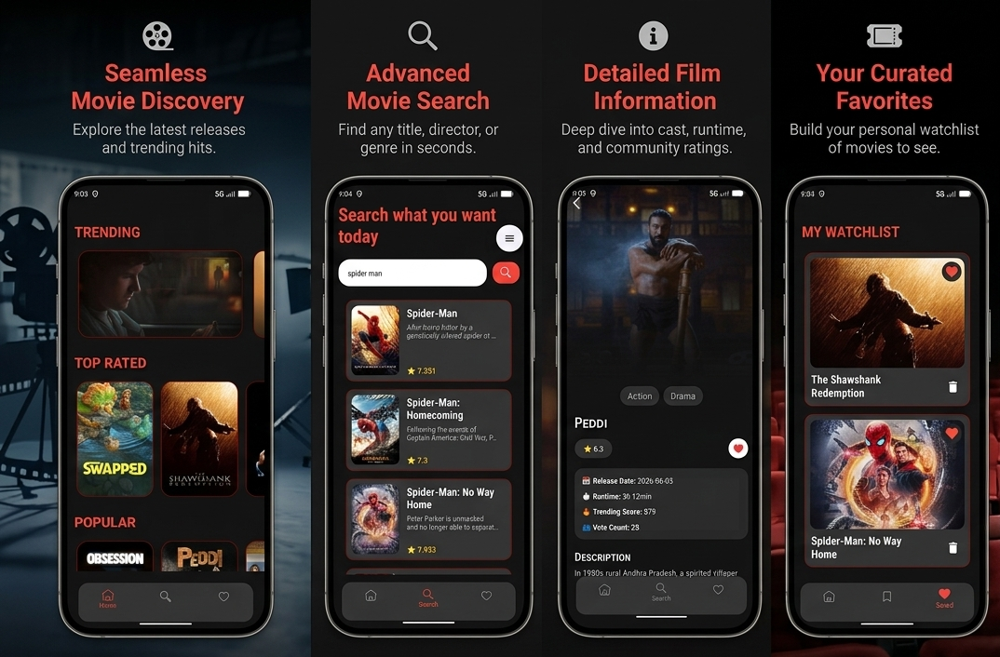

# 🎬 MovieBox

MovieBox is a modern Android application for discovering movies, searching for titles, viewing detailed information, and saving favorites for offline access.

The application uses the TMDB API for movie data and Room for local storage.

---

## ✨ Features

### 🏠 Home
- Trending movies
- Popular movies
- Top-rated movies
- Horizontally scrollable movie lists

### 🔍 Search
- Search movies by title
- Real-time API requests
- Loading and error states
- Search results display

### 🎬 Movie Details
- Movie overview
- Rating and vote count
- Release date
- Popularity
- Poster and backdrop images
- Navigation from movie lists to details

### ❤️ Favorites
- Save movies locally
- Remove movies from favorites
- Persistent storage with Room
- Favorites available without an internet connection

---

## 🛠 Tech Stack

- **Kotlin**
- **XML**
- **Retrofit**
- **Coroutines**
- **Room**
- **RecyclerView**
- **ViewBinding**
- **Material Design**

---

## 🌐 API

MovieBox uses the **TMDB API** to retrieve:

- Trending movies
- Popular movies
- Top-rated movies
- Search results
- Movie details

---

## 🏗 Architecture

The application follows an **MVVM-based architecture**.

- Retrofit handles network communication
- Coroutines handle asynchronous operations
- Room provides local data persistence
- ViewBinding is used for view access
- Fragments handle screen navigation
- UI states handle loading, success, and error scenarios

---

## 📱 Screenshots

---

## 🚀 Getting Started

1. Clone the repository
2. Open the project in Android Studio
3. Add your TMDB API key
4. Build and run the application

---

## 📌 Project Status

The application is fully functional and combines remote API data with local offline storage.
